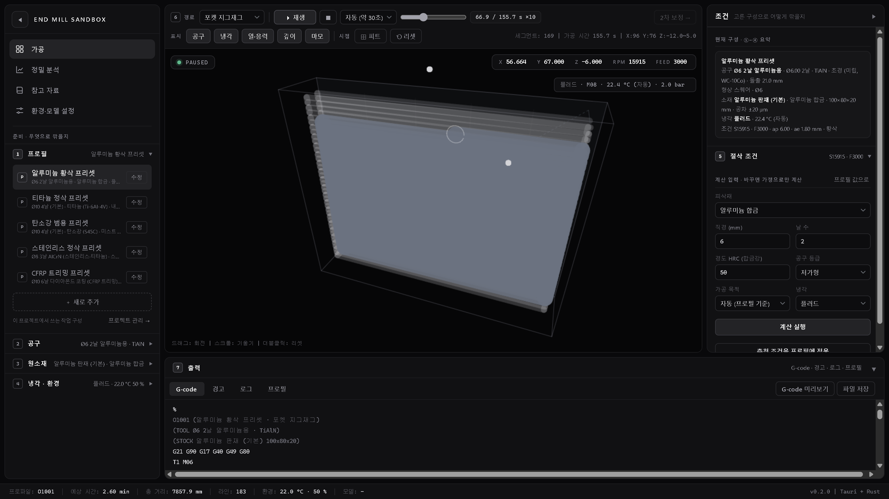
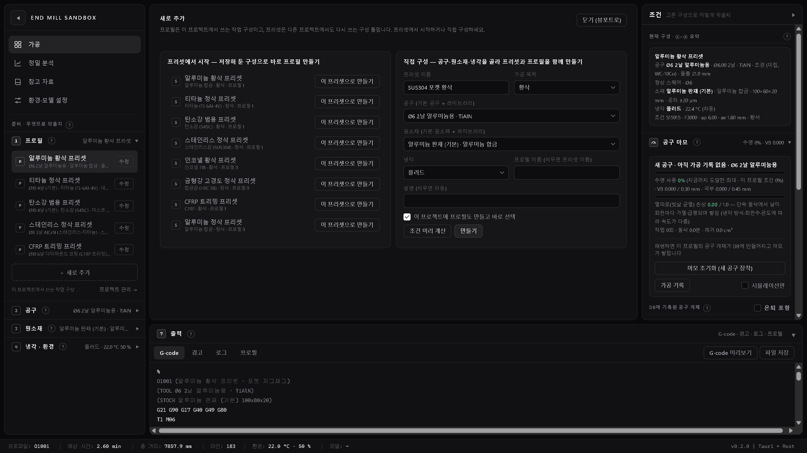
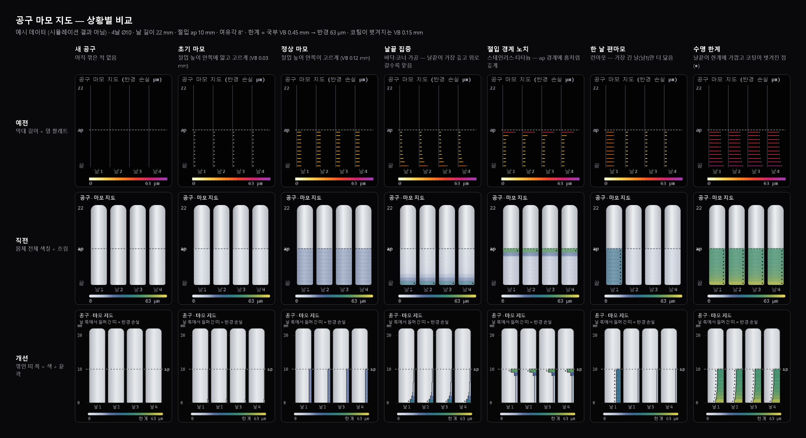

# 화면 흐름 점검과 배치 정리

"좌우 영역이 일관성 없이 나뉘어 있어 어디를 봐야 할지, 어디서 찾아야 할지 모르겠다"는 문제를 기준으로 가공 화면의 사용 흐름을 점검하고 배치를 다시 정리했습니다. 이어서 받은 의견(프로필/프리셋 혼동, 상단 바 정리, 무채색 톤, 깊이 색, 공구 마모 기록·초기화, 영역 설명)도 반영했습니다.



## 1. 실제 사용 순서

1. 프로필 고르기 (또는 새로 추가)
2. 공구 바꾸기 / 직접 만들기 — 고르면 프로필에 반영되고 절삭 조건을 다시 산정
3. 원소재 바꾸기 / 직접 만들기 — 위와 같음
4. 냉각 방식과 세부값, 작업장 온도·습도 정하기 — 고르면 프로필에 바로 반영
5. 절삭 조건 계산 → 결과 확인 → 프로필에 적용
6. 가공 경로를 고르고 재생 (계산 → 재생 → 열·깊이·마모 표시 → 2차 보정)
7. G-code·경고·로그 확인과 저장

## 2. 정리 전 상태에서 찾은 문제

| # | 문제 | 예 |
| --- | --- | --- |
| 1 | 같은 항목이 여러 곳에 흩어져 있음 | 냉각 3곳(왼쪽 목록, 오른쪽 '냉각 설정', 계산 입력), 환경 2곳, 재생 버튼 2곳, 프로필 요약 2곳 |
| 2 | 좌우를 나누는 기준이 없음 | 왼쪽에 목록과 재생 버튼, 오른쪽에 요약·계산기·설정·만들기 폼이 섞여 있음. 공구는 왼쪽에서 고르고 오른쪽에서 만듦 |
| 3 | 메뉴를 누르면 패널 내용이 다시 펼쳐짐 | 상단 '설정'은 별도 화면이 아니라 좌우 아코디언을 다른 조합으로 펼침. 실제 설정 화면 '모델·환경'과 이름도 겹침 |
| 4 | 순서와 현재 값이 안 보임 | 단계 번호가 없고, 접힌 섹션은 펼쳐야 무엇이 선택됐는지 보임 |
| 5 | 툴바 순서가 작업 순서와 다름 | 재생 버튼 뒤에서 가공 경로를 고름 |
| 6 | 프로필과 프리셋이 헷갈림 | '활성 프로젝트의 프로필' 목록과 '프리셋' 버튼 묶음이 한 섹션에 나란히 있고, 만들기는 레이어 팝업 |
| 7 | 섹션 안쪽 배치와 색이 제각각 | 2열·3열 격자, '적용' 버튼이 결과보다 먼저, 파란 채움 버튼이 곳곳에 강하게 보임 |

## 3. 바꾼 배치

```text
┌ 사이드바 ──────────────┬ ⑥ 경로 → 재생 → 2차 보정 →  /  표시 · 시점 ─┬ 「조건」 ──────────┐
│ [◀] END MILL SANDBOX   │ ┌ 상태 ┐                        ┌ X Y Z RPM FEED ┐│ 현재 구성 요약    │
│ 가공 · 정밀 분석        │                                                │ 공구 마모 · 초기화│
│ 참고 자료 · 환경·모델 설정│              시뮬레이션 뷰포트                │ ⑤ 절삭 조건       │
│ ── 준비 ──              │                                                │  입력→계산→적용   │
│ ① 프로필  ② 공구        ├────────────────────────────────────────────────┴───────────────────┤
│ ③ 원소재  ④ 냉각·환경   │ ⑦ 출력: G-code · 경고 · 로그 · 프로필                               │
└────────────────────────┴─────────────────────────────────────────────────────────────────────┘
```

- **영역별 역할 하나**: 사이드바는 화면 전환과 '무엇으로'(①–④), 오른쪽은 '어떻게'(현재 구성 · 공구 마모 · ⑤), 가운데는 실행과 보기(⑥), 아래는 결과물(⑦)입니다. 번호가 읽는 순서입니다.
- **상단 바 없앰**: 왼쪽 접기 버튼은 로고 자리(사이드바 맨 위)로, 화면 전환 메뉴는 사이드바 안으로, 좌표(DRO)와 상태 표시는 뷰포트 위 HUD로 옮겼습니다. 사이드바는 위에서 아래까지 이어지고, 접으면 아이콘 레일로 남습니다(단계 번호를 누르면 다시 펼쳐지며 그 단계가 열림).
- **한 항목은 한 곳에만**: 공구 목록·사양·커스텀 공구는 ②, 원소재 목록·커스텀 원소재는 ③, 냉각 방식·세부값·작업장 환경은 ④, 공구 마모 상태와 초기화는 오른쪽 '공구 마모'에 있습니다.
- **접어도 현재 값이 보임**: 단계 머리글 오른쪽에 지금 값이 보입니다(예: `② 공구 … Ø6 2날 알루미늄용 · TiAlN`).
- **프로필 목록에서 수정·추가**: 항목마다 이름 아래에 구성(공구 · 소재 · 냉각)이 보이고 '수정' 버튼이 있습니다. 목록 끝의 '＋ 새로 추가'를 누르면 가운데 영역을 덮는 화면이 열려, 프리셋에서 시작하거나 직접 구성합니다. '수정'은 같은 화면에서 공구·원소재·냉각 바꾸기, 새 이름으로 복제, 프리셋으로 저장, 삭제를 합니다(이름 바꾸기는 백엔드에 기능이 없어 복제로 안내).
- **툴바 두 줄**: 첫째 줄 실행(⑥ 경로 → 재생·정지·속도·위치 → 2차 보정 →), 둘째 줄 보기(표시 토글 → 시점 피트·리셋 → 경로 정보).
- **안쪽 격자 통일**: 입력은 같은 2열 격자, 섹션 안 순서는 입력 → 실행 → 결과 → 적용입니다.



## 4. 색 정리

- **화면 틀은 무채색**: 바탕·카드·테두리·글자를 회색 단계(zinc 계열)로만 구성했습니다. 선택된 메뉴·탭·단계는 한 단계 밝은 회색 면으로, 버튼은 채운 회색(실행·적용)과 테두리(보조·만들기)로만 구분합니다.
- **색은 값에만**: 정상·주의·위험 같은 상태와 차트·깊이·마모 같은 데이터에만 색을 남겼습니다. 뷰포트에서 깎인 경로는 밝은 강조색 대신 중간 회색 판으로 그려 덩어리져 보이지 않게 했습니다.
- **깊이 색 = 접촉 팔레트, 마모 색 = 열 팔레트**: 피삭재 깊이는 영상 참고 화면처럼 남색 → 청록 → 노랑으로 올라오는 '접촉' 팔레트를 추가해 기본값으로 정했습니다. 공구 마모는 한때 같은 팔레트와 '밝은 몸체 색칠' 방식으로 바꿨다가, 깊이와 위치가 잘 안 보여 예전 방식(막대 길이 + 열 팔레트)으로 되돌렸습니다(아래 9절). 다른 팔레트(지형·열·해양·흑백·접촉)는 설정에서 그대로 고를 수 있습니다.

## 5. 공구 마모 기록 점검과 초기화

**DB에 기록되는가 — 예, 프로필별 공구 자리마다 기록됩니다.**

| 항목 | 내용 |
| --- | --- |
| 저장 위치 | `<app_data>/library/library.sqlite` 의 `tool_instances` (공구 개체), `tool_wear_events` (마모 변화 이력), `jobs` · `job_passes` (작업별 VB 시작·끝) |
| 공구를 구분하는 기준 | 프로필마다 공구 자리 하나 (`slot_key = profile:<프로필 이름>`). 자리마다 지금 끼워진 '공구 개체'가 하나만 활성 상태이고, 공구 사양(지름·날 수·코팅 등)은 `geom_key` 로 함께 기록 |
| 쌓이는 값 | 날·높이별 마모 지도, VB(평균·국부), 누적 절삭 시간, 제거 부피, 작업 수, 열피로 손상, 수명 사용률, 실측 반영값 |
| 언제 쌓이나 | '시뮬레이션만'을 끈 채 재생(계산 실행)할 때마다 1차 가공·2차 보정 결과가 누적. '시뮬레이션만'을 켜면 읽기만 하고 기록하지 않음 |
| 초기화 | `tool_state_reset` — 지금 개체를 은퇴시키고(사유 '작업자 리셋 (새 공구 장착)') 다음 세대 개체로 새로 시작. 이전 개체와 이력은 DB에 그대로 남음 |
| 사양이 바뀌면 | 프로필의 공구 사양이 바뀐 뒤 다음 작업을 기록할 때 이전 개체를 은퇴시키고 새 개체로 시작 |

**찾은 문제**: 초기화 버튼은 있었지만 ② 공구 단계(기본 접힘) 안 공구 목록 아래에 묻혀 있었고, 프로필별 개체를 한눈에 보는 목록 명령(`tool_instances`)은 화면 어디에서도 쓰지 않고 있었습니다.

**바꾼 것** — 오른쪽 패널 '현재 구성' 아래에 **공구 마모** 영역을 두었습니다.

- 머리글에 '수명 n% · VB n.nnn' 요약이 보입니다.
- 현재 프로필의 공구 개체 카드(수명 사용률, VB, 열피로, 작업 수·절삭 시간), DB 기록 상태 한 줄('DB 기록 중 · 공구 개체 #n' 또는 기록 전 안내), 최근 마모 이력 4건(시각 · 1차 가공/2차 보정/실측/교체 대기/초기화 · VB 변화 · 누적 분)
- 전체 폭 **마모 초기화 (새 공구 장착)** 버튼 — 4초 안에 한 번 더 눌러야 실행
- **DB에 기록된 공구 개체** 목록 — 프로필마다 활성 개체의 수명·VB·작업 수와 '초기화' 버튼(역시 두 번 눌러 실행). '은퇴 포함'을 켜면 초기화·교체로 물러난 개체와 사유도 보입니다.

## 6. 영역별 설명 툴팁

- 각 영역 제목 옆의 **?** 에 마우스를 올리거나 Tab 키로 초점을 주면 설명이 뜹니다: 준비 그룹, ①–④ 단계, ⑥ 툴바(실행 줄 · 표시 줄), 현재 구성, 공구 마모, DB 공구 개체 목록, ⑤ 절삭 조건, ⑦ 출력.
- 화면 메뉴 4개와 뷰포트의 상태·좌표 표시는 항목 자체에 마우스를 올리면 설명이 뜹니다(접힌 아이콘 레일에서는 메뉴 이름도 함께).
- 툴팁은 패널 밖(화면 위)에 띄워 스크롤 영역에 잘리지 않고, 화면 가장자리에서는 위·왼쪽으로 비켜 섭니다. 머리글의 ? 를 눌러도 단계가 접히거나 펼쳐지지 않습니다.

## 7. 바뀐 동작

- 상단 '설정' 메뉴 제거. 그 메뉴가 펼치던 목록과 만들기 폼은 사이드바 ②–④에 항상 있습니다.
- 왼쪽 '애니메이션'·'리셋' 섹션 제거(재생은 툴바 ⑥, 시점 리셋은 툴바 둘째 줄과 뷰포트 더블클릭).
- 빈 '프로젝트' 섹션 제거. ① 아래 '프로젝트 관리 →'로 정밀 분석 ⑦ 라이브러리 탭을 엽니다.
- 프리셋 레이어 팝업 제거. 같은 입력 항목이 가운데 '새로 추가' 화면으로 옮겨졌고, '현재 → 프리셋'은 '수정' 화면의 '프리셋으로 저장'이 대신합니다.
- 냉각 방식은 ④ 목록에서 고릅니다. 세부값 폼의 같은 기능 선택칸은 숨겼습니다.
- 공구 상태 카드를 ② 공구에서 오른쪽 '공구 마모'로 옮기고, 버튼 이름을 '마모 리셋'에서 '마모 초기화'로 바꿨습니다.
- 오른쪽 패널을 접으면 그 열과 간격을 모두 비워 가운데(와 아래 출력)가 오른쪽 끝까지 채우고, 다시 열 때는 가운데 툴바 첫 줄 끝에 나타나는 '◀ 조건' 버튼을 누릅니다. 아래 패널을 접으면 38px 머리글 바(⑦ 출력 + 펼치기 버튼)로 남습니다. 예전에는 펼치기 버튼이 옆 패널 위로 튀어나와 배경색이 같아 잘 보이지 않았고, 가운데 화면(정밀 분석 등)이 열리면 그 아래에 가려졌습니다. 접기 버튼에는 테두리와 배경을 넣었습니다.
- 백엔드 설정 값 목록에 `contact` 팔레트를 추가하고 깊이 기본 팔레트를 `contact`로 바꿨습니다. 공구 마모 기본 팔레트는 `thermal`(열) 그대로입니다(`src-tauri/src/commands.rs`). 이미 저장된 표시 설정이 있으면 그 값이 유지되므로, 바로 보려면 '환경·모델 설정 → 절삭 깊이 · 공구 마모 표시'에서 고르면 됩니다.

## 8. 확인한 것과 남은 것

- 백엔드 없이, 소스의 기본 프리셋 구성으로 만든 예시 데이터를 넣어 미리보기에서 확인했습니다. 단계 요약, 프로필 수정·새로 추가 화면, 설정 화면 전환 시 패널 유지, 사이드바 접기(아이콘 레일)와 복원, HUD 좌표 갱신, G-code 미리보기, 1600×900·1280×720 배치를 확인했고 콘솔 오류는 없었습니다. 마모 미니 창과 팔레트는 시험용 마모 값으로 그려 확인했습니다.
- 공구 마모 영역은 '기록 없음'과 시험용 기록(개체 2개 + 은퇴 1개, 이력 4건) 두 상태로 확인했습니다: 머리글 요약, DB 기록 줄, 이력 표시, '은퇴 포함' 전환, 목록의 두 번 눌러 초기화. 툴팁은 표시 위치와 ? 클릭 시 단계가 바뀌지 않는 것을 확인했습니다.
- 위 스크린샷도 같은 예시 데이터로 찍은 화면입니다(물리 계산 결과는 들어 있지 않음).
- 실제 앱(Tauri)에서 실제 데이터로는 아직 확인하지 않았습니다. Rust 변경(팔레트 목록·깊이 기본값)은 컴파일해 보지 않았습니다.

## 9. 공구 마모 지도 — 세 방식 비교와 되돌린 이유

같은 예시 마모 값(4날 Ø10, 날 길이 22 mm, 절입 10 mm)을 세 방식으로 그린 비교입니다. 맨 위 '예전' 줄이 지금 앱에 들어간 방식입니다.



**'직전'(몸체 색칠) 방식에서 깊이와 위치가 잘 안 보였던 이유**

1. **깊이를 색으로만 그림** — 예전은 반경 손실을 막대 길이로 그렸는데, 직전 방식은 날 몸체 전체 폭을 칠해 길이 정보가 없어졌습니다. 길이는 색보다 훨씬 정확하게 읽힙니다.
2. **흔한 마모가 거의 흰색** — 지도의 100%는 국부 마모 한계(VB 0.45 mm → 여유각 8°에서 반경 약 63 µm)입니다. 자주 보는 VB 0.03~0.15 mm는 한계의 5~35%라, 접촉 팔레트의 흰색~연파랑 구간에 들어가 흰 몸체 위에서 거의 보이지 않았습니다(그림의 '초기 마모'·'정상 마모').
3. **밝기가 거꾸로** — 접촉 팔레트는 흰색 → 남색(어두움) → 노랑(밝음)이라, 가장 심한 마모(노랑)가 흰 몸체와 밝기가 비슷해 오히려 약해 보였습니다.
4. **높이가 번짐** — 1.5px 흐림과 겹쳐 칠한 칸 때문에 이웃 높이가 섞여, 노치처럼 좁은 곳의 위치가 흐려졌습니다. 반투명(0.35~1)으로 그라데이션 몸체 위에 칠해 범례 색과도 달라졌습니다.

예전 방식은 날마다 세로 기준선에서 반경 손실만큼 막대를 그어 **막대 길이 = 깊이, 막대 높이 = 위치**가 바로 읽히고, 열 팔레트(연노랑 → 주황 → 빨강 → 자주)가 어두운 바탕에서 잘 보입니다. 그래서 이 방식으로 되돌렸습니다. 고해상도 화면에서 선명하게 그리는 것만 더했습니다.

**지도 읽는 법** (그림의 각 열)

| 상황 | 지도에서 보이는 모습 |
| --- | --- |
| 새 공구 | 막대 없음 |
| 초기 마모 | ap 아래에 아주 짧은 막대가 고르게 |
| 정상 마모 | ap 아래에 같은 길이의 막대가 고르게 |
| 날끝 집중 (바닥·코너 가공) | 날끝(아래)으로 갈수록 길고 붉어짐 |
| 절입 경계 노치 (스테인리스·티타늄) | ap 점선 바로 아래만 툭 길어짐 |
| 한 날 편마모 (런아웃) | 한 날만 막대가 길다 |
| 수명 한계 | 막대가 길고 빨강·자주에 가깝고, 막대 끝에 흰 점(코팅 벗겨짐) |

**뷰포트 공구 위 마모 표시와 같은 색인가 — 예.** 공구 위에 그리는 마모 표시와 지도 막대, 범례는 모두 같은 함수(`vpWearRgb`)와 같은 기준(국부 한계 × tan 여유각)으로 색을 정하므로, 같은 날·같은 높이는 두 곳에서 같은 색입니다. 다른 점은 길이의 기준(공구 위는 공구 반지름 기준, 지도는 칸 폭 기준)과, 공구 위는 VB 0.002 mm 미만의 아주 작은 마모를 생략한다는 것뿐입니다.
